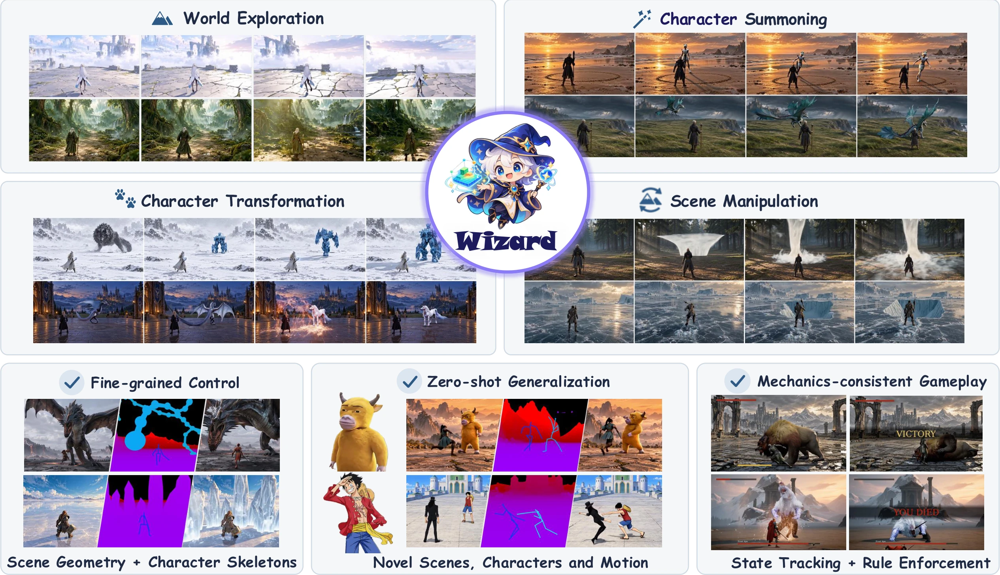
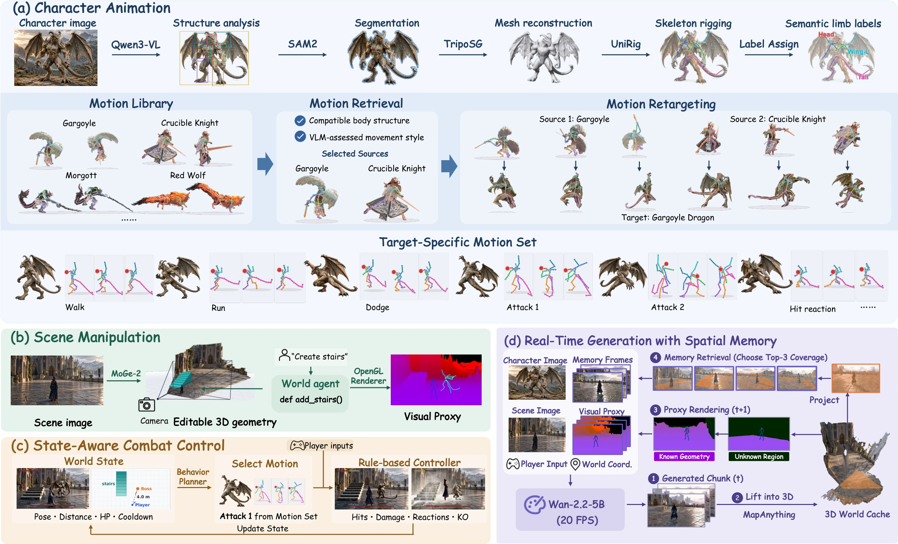
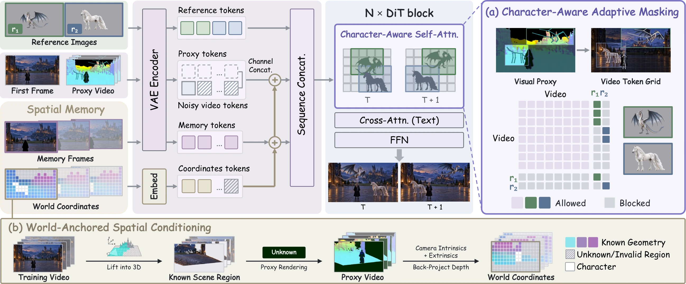
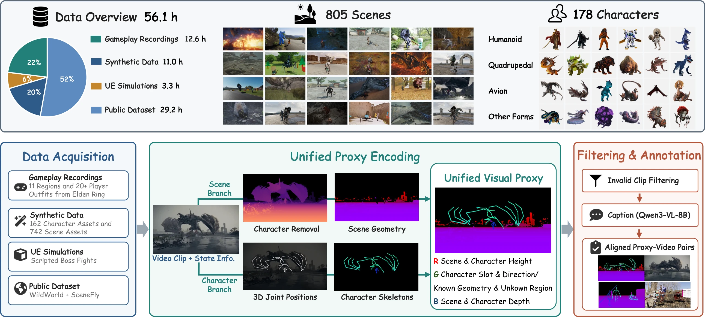

<div align="center">

# Wizard: Manipulate Any World in Real Time via Agentic Control

[Yuzhe Wu](https://github.com/wyzardWu)<sup>1,2,\*</sup> · [Zijun Lin](https://jimntu.github.io/)<sup>1,3,\*</sup> · [Yeying Jin](https://jinyeying.github.io/)<sup>1,2,♢</sup>

<sup>1</sup>Tencent · <sup>2</sup>National University of Singapore · <sup>3</sup>Nanyang Technological University
<br><sup>\*</sup>Equal contribution · <sup>♢</sup>Corresponding author and project leader

[](https://arxiv.org/abs/2610.40339)
[](https://wyzardwu.github.io/wizard/)
[](https://huggingface.co/datasets/yuzhewu207/wizard)
[](https://huggingface.co/datasets/yuzhewu207/wizard-precoded)
[](LICENSE.md)



**Change the world as you play.** Wizard keeps the game state explicit and lets a real-time video model paint it.<br>
Watch the trailer and the interactive demos on the [project page](https://wyzardwu.github.io/wizard/).

</div>

## News

- **2026-11** Training and inference code, model weights, the raw training data and the pre-encoded training data are released.

## Overview

Game world models can generate interactive video in real time, but a game needs more than walking around: a boss that
appears and fights by its own rules, a creature that turns into another, ground that splits or rises on command.
Wizard keeps the game state explicit: scene geometry for the world, an articulated skeleton for every character, and
rules for the fight. Agents edit that state from one image, a typed instruction or a key press, and render it into a
**visual proxy**; a causal video model built on [Wan2.2-TI2V-5B](https://github.com/Wan-Video/Wan2.2) turns the proxy
into game frames at **20 FPS with two denoising steps**. Every scene and character shown on the project page is new to
the model.

## Highlights

- **Proxy-driven control.** Scene geometry and articulated skeletons are rendered into one condition video and
  concatenated with the video latents: precise camera and motion control, zero-shot to new scenes, characters and motions.
- **Geometry you can trust.** The proxy marks every pixel as *exact*, *coarse* or *unknown*; the model follows exact
  geometry and invents unknown regions, which are then filled online from the generated frames.
- **Character-aware adaptive masking.** Each reference image may attend only to its own character's skeleton-derived
  region (expanded by 25%). The masks follow the characters and reduce appearance leakage; on a transformation they block
  the old identity's cached tokens.
- **World-anchored spatial conditioning.** An explicit scene map is projected into the memory frames and the current proxy
  as per-pixel world coordinates, kept only where the scene has been seen. Revisited places are re-rendered from the new
  view rather than copied (copy bias 6.61 → 2.84), while unexplored regions stay free to generate.
- **Real time.** Following Causal Forcing++: teacher forcing with history self-augmentation, consistency distillation
  with a 20-latent-frame window and a first-frame sink, then DMD on the student's own rollouts. Online world maintenance
  runs on a second GPU without blocking generation.

## Method

A setup stage of under five minutes reconstructs the scene and characters, rigs skeletons and builds each character's
motion set. During play, the agents update motion, geometry and combat state, and the generator renders them.

<div align="center"><br><em>Inference pipeline: (a) character animation, (b) scene manipulation, (c) state-aware combat, (d) real-time generation with spatial memory.</em></div>

<br>

<div align="center"><br><em>Generator with (a) character-aware adaptive masking and (b) world-anchored spatial conditioning.</em></div>

**This repository contains the video generator** (d): the four-stage training pipeline and the three inference modes,
including online world maintenance. The agents that build and drive the proxy (rigging, motion retargeting, combat
simulation, the world agent and the interactive front end) are not part of this release; the
[examples](https://huggingface.co/datasets/yuzhewu207/wizard/tree/main/examples) provide ready-made proxies to run the
generator on.

## Installation

```bash
git clone https://github.com/YeyingLab/Wizard.git && cd Wizard
conda create -n wizard python=3.12 -y && conda activate wizard
pip install torch==2.11.0 torchvision --index-url https://download.pytorch.org/whl/cu128
pip install -r requirements.txt
pip install -e .

huggingface-cli download Wan-AI/Wan2.2-TI2V-5B --local-dir checkpoints/Wan2.2-TI2V-5B
export WAN_CKPT=$PWD/checkpoints/Wan2.2-TI2V-5B      # the VAE, T5 and tokenizer are used as-is
```

`ffmpeg` must be on the `PATH`. Online world maintenance additionally needs
[MapAnything](https://github.com/facebookresearch/map-anything), which can live in its own environment (see
[docs/INFERENCE.md](docs/INFERENCE.md)). Tested with Python 3.12 and PyTorch 2.11 (CUDA 12.8) on H200 GPUs.

## Quick start

```bash
# the real-time model and five ready-made cases (first frame, proxy video, reference images, our outputs)
huggingface-cli download yuzhewu207/wizard --repo-type dataset \
    --include "weights/causal_dmd/ema_step400.safetensors" "examples/*" --local-dir hf_wizard
W=hf_wizard/weights/causal_dmd/ema_step400.safetensors

# real-time 2-step causal student: an 8 s duel with a character already in the first frame, and an 8 s world edit
C=hf_wizard/examples/duel_bull_character
bash scripts/infer/run_case.sh causal $W $C out.mp4 --ref1 $C/ref_a.png --ref-slots 2,0
C=hf_wizard/examples/world_edit_stairs
bash scripts/infer/run_case.sh causal $W $C out.mp4 --ref-slots 0,0

# the same with an online-maintained 3D world (the case needs world_px.npz); FAST=1 runs the maintenance on the second GPU
CUDA_VISIBLE_DEVICES=0,1 FAST=1 bash scripts/infer/run_case.sh world <dit> <case> out.mp4

# the bidirectional teacher (30 steps, CFG 3)
bash scripts/infer/run_case.sh bidirectional <bidirectional dit> <case> out.mp4
```

Each run writes `out.mp4` (generation | proxy side by side) and `out_gen.mp4` (generation only). The case format is
described in [docs/DATA.md](docs/DATA.md).

## Model zoo

DiT checkpoints fine-tuned from Wan2.2-TI2V-5B, in the `weights/` folder of
[`yuzhewu207/wizard`](https://huggingface.co/datasets/yuzhewu207/wizard):

| Checkpoint | Stage | Sampling |
|---|---|---|
| `causal_dmd/ema_step400.safetensors` | 4 · real-time causal student (DMD of `causal_cd`, step 400 of 500) | `causal` / `world`, 2 steps |
| `causal_dmd/ema_step480.safetensors` | 4 · DMD student from an earlier run of the chain, kept for comparison | `causal` / `world`, 2 steps |
| `causal_cd/ema_step10000.safetensors` | 3 · consistency-distilled causal student | `causal` / `world`, 2 steps |
| `causal_teacher/dit_step11000.safetensors` | 2 · causal teacher | teacher of stage 3 |
| `bidirectional/dit_step35000.safetensors` | 1 · bidirectional teacher, all data incl. world-edit clips | `bidirectional`, 30 steps, CFG 3 |

`causal_cd` is the consistency student of the released chain (stage 3 run from `causal_teacher` with the scripts below).
`causal_dmd/ema_step400` is the DMD student of this `causal_cd` at step 400 of a 500-step run, chosen over steps 300–500 by evaluation. `ema_step480` comes from an earlier run of the chain.

**Other base models.** The approach is not tied to Wan: the visual proxy, the reference binding and the training recipe
carry over to other video backbones. We also trained it on [LTX-2.5](https://huggingface.co/Lightricks/LTX-2.5) (22B)
as a LoRA: [`weights/ltx25_lora/`](https://huggingface.co/datasets/yuzhewu207/wizard/tree/main/weights/ltx25_lora)
(an earlier proxy format without tiers or memory). Its inference code, a patch to LTX-2 with the reference-image
binding plus a runner, is in [`ltx/`](ltx/README.md) with three ready-made cases; that folder and the LoRA are under the
LTX-2.x Community License.

## Data

56.1 hours of proxy–video pairs from four sources, each adding what the others lack: 805 scenes and 178 characters.

| Source | Adds | Hours |
|---|---|---:|
| Public datasets | WildWorld + SceneFly: diverse creature bodies and scenes, with skeleton and depth | 29.2 |
| Gameplay recordings | Elden Ring: 11 regions, 20+ outfits, six bosses | 12.6 |
| Synthetic | 162 characters, 742 scenes; entry, coexistence, re-appearance, rapid turns | 11.0 |
| UE simulations | scripted boss fights with exact proxies | 3.3 |

<div align="center"><br><em>Dataset overview and processing pipeline.</em></div>

- **Pre-encoded training data**: the exact files the models were trained on,
  [`yuzhewu207/wizard-precoded`](https://huggingface.co/datasets/yuzhewu207/wizard-precoded) (804 GiB).
  ```bash
  python scripts/data/restore_precoded.py --root /path/to/wizard_data --verify   # download, extract, fix paths, check sha256
  export WIZARD_DATA=/path/to/wizard_data
  ```
- **Raw training data**: videos, proxy videos, geometry, memory banks and reference images,
  [`yuzhewu207/wizard`](https://huggingface.co/datasets/yuzhewu207/wizard).
- **WildWorld**: about half of the training windows come from [WildWorld](https://huggingface.co/datasets/AlayaLab/WildWorld),
  which cannot be redistributed;
  [`ww_index`](https://huggingface.co/datasets/yuzhewu207/wizard-precoded/tree/main/ww_index) lists the windows and the
  scripts to rebuild them from the upstream dataset.

Layout, groups and the proxy encoding: [docs/DATA.md](docs/DATA.md).

## Training

All stages run on 8 GPUs with FSDP (one 121-frame window per GPU) and reproduce the settings of our runs:

```bash
bash scripts/train/1_bidirectional.sh runs/bidirectional                                        # stage 1, 35k steps
bash scripts/train/2_causal.sh runs/bidirectional/dits/dit_step35000.safetensors runs/causal    # stage 2, 11k steps
bash scripts/train/3_consistency.sh runs/causal/dits/dit_step11000.safetensors runs/cd           # stage 3, 10k steps
bash scripts/train/4_dmd.sh runs/cd/ema/ema_step10000.safetensors \
    runs/bidirectional/dits/dit_step35000.safetensors runs/dmd                                   # stage 4, 500 steps
```

| Stage | Module | Script |
|---|---|---|
| 1 · bidirectional teacher | `wizard.train.bidirectional` | `scripts/train/1_bidirectional.sh` |
| 2 · causal teacher (teacher forcing + history self-augmentation) | `wizard.train.causal_selfaug` | `scripts/train/2_causal.sh` |
| 3 · consistency distillation | `wizard.distill.consistency_selfaug_future` | `scripts/train/3_consistency.sh` |
| 4 · distribution matching distillation | `wizard.distill.dmd_future` | `scripts/train/4_dmd.sh` |

Every stage can start from the released checkpoint of the previous one. Hyper-parameters, resuming and environment
switches: [docs/TRAINING.md](docs/TRAINING.md).

## Repository structure

```
wizard/
├── models/       DiT, flow-matching scheduler, proxy and reference injection, world tokens and memory
├── data/         proxy encoding, G-buffer, depth completion, video I/O
├── memory/       memory retrieval (shared by training and inference)
├── train/        stages 1 and 2
├── distill/      stages 3 and 4
├── inference/    bidirectional, causal and causal + world maintenance; KV-cache streams
├── world/        online world maintenance (point cache, meshes, reconstruction workers)
└── vendor/wan/   Wan2.2 VAE and T5 encoder
configs/          accelerate / FSDP configs
scripts/          training, inference and data-restore entry points
tools/            case utilities
docs/             data, training and inference guides
```

## Reproducibility

This code was reorganised from our research code and checked against it on the same inputs and seeds: all three
inference modes produce bit-identical videos, and every training stage produces the same loss on its first step (later
steps differ only by the run-to-run nondeterminism of the GPU backward pass, which the original code shows as well). The
data loaders of every stage read the released data with the same row counts as our training logs.

## Citation

```bibtex
@article{wu2026wizard,
  title   = {Wizard: Manipulate Any World in Real Time via Agentic Control},
  author  = {Wu, Yuzhe and Lin, Zijun and Jin, Yeying},
  journal = {arXiv preprint arXiv:2610.40339},
  year    = {2026}
}
```

## Acknowledgements

We build on [Wan2.2](https://github.com/Wan-Video/Wan2.2) (the VAE and T5 encoder in `wizard/vendor/wan` are taken
from it) and [DiffSynth-Studio](https://github.com/modelscope/DiffSynth-Studio) (flow-matching scheduler). The causal
adaptation and distillation follow Causal Forcing++, [CausVid](https://github.com/tianweiy/CausVid),
[Self-Forcing](https://github.com/guandeh17/Self-Forcing) and [DMD2](https://github.com/tianweiy/DMD2); world maintenance
follows [GEN3C](https://github.com/nv-tlabs/GEN3C) and uses [MapAnything](https://github.com/facebookresearch/map-anything).
The proxy pipeline uses [Qwen3-VL](https://github.com/QwenLM/Qwen3-VL), [SAM 2](https://github.com/facebookresearch/sam2),
[TripoSG](https://github.com/VAST-AI-Research/TripoSG), [UniRig](https://github.com/VAST-AI-Research/UniRig) and
[MoGe-2](https://github.com/microsoft/MoGe); the training data includes [WildWorld](https://huggingface.co/datasets/AlayaLab/WildWorld),
[SceneFly](https://huggingface.co/datasets/Orange-3DV-Team/SceneFly) and CombatMotion.

## License

The code is released for non-commercial research use only; see [LICENSE.md](LICENSE.md). The weights and data on
HuggingFace are for research use only under their own terms.
